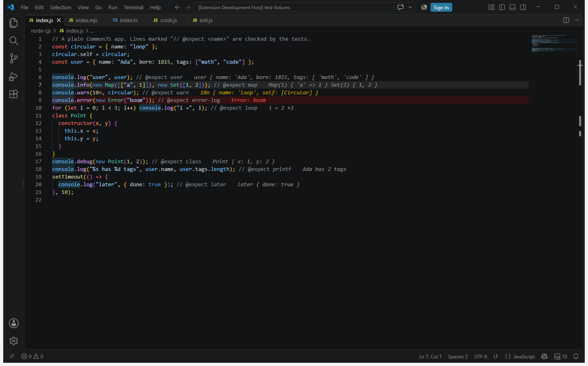

# Inline Logs

See what your code logs right next to the line that logged it. Start your app, your dev server or your tests in the VS Code terminal as you always do. Each `console.log` value shows at the end of its line, a crash shows in red on the line that threw and in the Problems panel, and each `fetch` or WebSocket message shows on the line that made it. Logs from pino, winston, consola and tslog land on the line that called them too.

Free and open source. Nothing to set up and nothing leaves your machine.

## What it does

- The latest value at the end of the line that logged it, in grey. Warnings in yellow.
- Uncaught errors and unhandled rejections in red on the line that threw, and in the Problems panel.
- A line that ran more than once shows `×3` at the end. Hover it for the full value and each run with its time and value.
- A line with several calls, such as `fetch(url).then((r) => console.log(r))`, shows each call's newest value side by side, left to right.
- `console.table`, `console.dir` and `console.trace` too. The line shows the table's size and columns, the object, or the trace message. The hover shows the drawn table, the whole object, or the call stack.
- `console.count`, `console.time` and `timeEnd`, `console.group` and a failing `console.assert`, each on its own line.
- pino, winston, consola and tslog, on the line that called them, in their level's colour.
- Insert a `console.log` for the name under the cursor, and comment out, uncomment or remove every `console` call in a file.
- A log viewer in the bottom panel. Search it with the same words as Search Logs, or filter by level. Click an entry to jump to its line.
- Edit the file and values move with their lines. A line you change loses its old value.
- The status bar shows the entry count. Click it to pause and resume. While paused it says Paused.
- Network requests, WebSocket and EventSource messages and beacons on the line that made them: method, status, time and URL, with headers and bodies in the hover. Secrets are redacted.
- Copy a value as JSON, and export everything captured to a JSON or text file.
- Compare a value with the one before it from the same line, or any two values, in VS Code's diff editor.
- Search everything captured, from the command or the log viewer's own search box, and the Log Map, a tree of every file and line with a value.
- A value graph: objects and arrays drawn as boxes you can zoom, pan and fold.
- Code coverage in the gutter for Node and Deno apps, when you turn it on.
- An MCP server, when you turn it on, so AI tools can read the logs, errors and requests.

## Get started

1. Install the extension.
2. Open a **new** terminal in VS Code.
3. Run your app: `node app.js`, `npm run dev`, `npx tsx src/index.ts`, `npm test`, `bun app.js`, and so on.

That is all. Terminals that were open before the install do not have it until you open a new one.

## What it works with

| Where your code runs | How |
| --- | --- |
| Node, CommonJS and ES modules | Anything started from the VS Code terminal |
| TypeScript | Through tsx, ts-node, or compiled code with source maps. Values land on the `.ts` line |
| Next.js | `next dev`, with Turbopack or webpack. Server code (also in the Edge runtime) and browser code, app router and pages router |
| The browser, with Vite | Start the Vite dev server in the VS Code terminal and open the page in any browser |
| The browser, with webpack | `webpack serve` (webpack-dev-server), with webpack's default, `eval-source-map` or `source-map` setting |
| Jest and Vitest | Logs inside your tests land on the test's lines |
| Bun | `bun app.js`, `bun run` and `bun test` |
| Deno | `deno run` with the permissions the script needs, such as `-A` |
| Svelte and SvelteKit | `vite dev`. Server `load` functions, components in the browser, and Svelte 5's `$inspect` |
| Nuxt | `nuxt dev`. Server rendering, server API routes, and the browser |
| Astro | `astro dev`. The frontmatter on the server, and `<script>` tags in the browser |
| React Router 7 (Remix) | `react-router dev`. The browser, and loaders and actions on the server |
| Monorepos | Workspaces of packages running at once (Turborepo, npm workspaces and the like), and windows with several folders. Each value lands on its own package's file |
| A terminal outside VS Code | Windows Terminal, PowerShell, iTerm and others, after you paste one line (see below) |
| Remote windows | WSL, SSH, dev containers and Codespaces. The extension runs on the remote side, next to your app |

Values are shown the way a console prints them: objects, arrays, `Map`, `Set`, class names, errors, `BigInt`, circular references. Very large or deep values are cut short, so a big object never slows your app down.

## Dev servers in the browser

Run your dev server in the VS Code terminal and open the page in any browser. Nothing to add to your config. While the dev server runs, the pages it serves get a small script that sends the page's console output and errors back to the dev server, which passes them to VS Code. The script takes itself out of the page before your framework starts, so React and others never see it.

- **Vite**: `npm run dev` or `vite`. Code Vite compiles, like TypeScript, lands on the right line through Vite's own source maps.
- **Next.js**: `next dev`. Server components, route handlers and `getServerSideProps` log from the Next.js server. Client components log from the browser. Both land on your source lines, through Turbopack's or webpack's source maps.
- **webpack**: `webpack serve`, or your own server script that loads webpack-dev-server or webpack-dev-middleware, with `require` or `import`. webpack's default development setting (`eval`) has no source maps, so lines are found by matching your file with the code webpack runs. The `eval-source-map` and `source-map` settings use their maps.
- **SvelteKit, Nuxt, Astro and React Router**: their dev commands run on Vite, and their pages get the script the same way. Nuxt's pages come through its server worker, and that works too. Server code that Vite runs from memory (React Router's loaders and actions) lands on its line through the source map Vite puts in that code.
- **Svelte 5**: `$inspect(value)` shows each new value on the `$inspect` line, with `×N` for the number of changes. Svelte's own folded "stack trace" group after each one stays in the browser's console.

Production builds are never touched. Only pages served by a dev server started from a VS Code terminal get the script.

## Requests

Each `fetch`, `XMLHttpRequest` and Node `http` or `https` call shows at the end of the line that made it: `GET 200 · 12 ms · http://localhost:3000/api/user`. A 4xx answer is yellow, a 5xx answer or a request that failed is red. The hover shows the request and response headers and bodies, and when the body ended. Calls a library makes for your code, such as axios, land on your line.

WebSockets, in the browser, with the built-in `WebSocket` in Node 22 and later, Bun and Deno, and with the `ws` package: the socket opening, each message it receives and its close show on the line that made the socket, and each message sent shows on the line that sent it: `WS ↑ 37 B · {"type":"hello"}`. An error is red and a close that was not normal is yellow. Messages are redacted like bodies, binary ones show as their size, and up to 200 messages per socket are kept. Secret values in the socket's address, such as `?token=`, show as `[redacted]`. An `EventSource` shows the same way, with `SSE` in place of `WS`, and `navigator.sendBeacon` as `POST beacon queued` with its body.

- Node, Bun and Deno: `fetch`, `http.request`, `http.get`, `https.request` and `https.get`, the built-in `WebSocket` and `EventSource`, and the `ws` package's `WebSocket` (in Node).
- The browser, for pages from a dev server started in the terminal: `fetch`, `XMLHttpRequest`, `WebSocket`, `EventSource` and `navigator.sendBeacon`.
- Bodies that are text or JSON are kept up to 16,000 characters, also the body of a `Request` object passed to `fetch`, and `http` bodies sent compressed (gzip, deflate, br, zstd). Bodies are read from a copy, so your app gets its whole body and the same request and response objects as always.
- The time on the line runs from the call to the response headers. The hover also says when the body ended: for `http`, `https` and `XMLHttpRequest` always, and for `fetch` when the body is text or JSON, read on from the copy up to 1 MB.
- `Authorization`, `Proxy-Authorization`, `Cookie`, `Set-Cookie`, `X-Api-Key` and similar headers show as `[redacted]`, and so do JSON and form fields named like a password, token, secret or API key. This happens inside your app, before anything is sent to VS Code.

Turn it off with `inlineLogs.requests`, or keep requests but not their bodies with `inlineLogs.requestBodies`. **Pause or Resume Request Log** stops new requests for a while and keeps console output coming.

## Logging libraries

pino, winston, consola and tslog calls show on the line that called them, with the message and its fields. Info is blue, warnings yellow, errors red, and debug grey. The hover names the library and level. Their output, levels and transports stay exactly as they are.

- **pino**: every level that is on, with its merged fields. A level pino leaves out is left out here too.
- **winston**: every call a transport takes, through `logger.info()` and the rest, `logger.log()` and child loggers.
- **consola**: what it prints to the terminal, with its level from its badge or icon.
- **tslog**: its pretty output, and its JSON output when tslog records where each call was made (`stack: { capture: "on" }`). tslog writes JSON lines later, in batches, so a line without that position has nothing that says which line made it, and is not shown.

## Insert and clean up logs

| Command | Keys | What it does |
| --- | --- | --- |
| Insert Log for Selection | Ctrl+K L (Cmd+K L on Mac) | Adds `console.log("file.ts:12 user", user)` for the selection, or the name under the cursor with the object it belongs to, on the line after its statement |
| Comment Out Console Calls in This File | Ctrl+K Shift+C | Turns each `console` call that is a statement of its own into a comment |
| Uncomment Console Calls in This File | Ctrl+K Shift+U | Turns commented-out `console` calls back into code |
| Remove Console Calls in This File | Ctrl+K Shift+D | Removes each `console` call, with its line when it has the line to itself |

They read the file with TypeScript's own parser, so text that only looks like a call, in a string, a template or a comment, is never touched, and a call over several lines is one call. The new log uses the file's indentation, quotes and semicolons. A name in a function's parameters, a loop's variable or an if's condition gets its log first in the block, and a log for a name on a `return` line goes before that line. A call that is part of a larger expression, such as `a || console.log(b)`, is left as it is, and the status bar says how many. A call that is the whole body of an `if` or an arrow function becomes `{}` when removed. Each command is one step to undo.

They work in JavaScript and TypeScript files, JSX and TSX, the `<script>` of Svelte, Vue and HTML files, and the frontmatter and `<script>` of Astro files. The keys are two steps: Ctrl+K, then the letter. The Mac keys use Cmd in place of Ctrl. None of them is one of VS Code's own keys on Windows, Linux or Mac, and none uses Alt, so keyboards that type letters with AltGr keep them.

## Problems panel

Uncaught errors also show in VS Code's Problems panel, on the line that threw, so tools that read it, such as Error Lens, show them too. An error goes when you edit its line, when a new run of the same program starts (the same folder and script), when the page it came from loads again, or when you run **Clear Values**. Turn it off with `inlineLogs.problems`.

## Terminals outside VS Code

Run **Copy Setup for an Outside Terminal**, pick the shell (PowerShell, Command Prompt, bash or zsh, fish), and paste the line it copies into that terminal. Apps you start there after it report to this VS Code window, the same way as from VS Code's own terminal. The line sets `NODE_OPTIONS` and the extension's port and key for that terminal only. The connection goes to `127.0.0.1` only, and the key changes each time VS Code starts, so paste a new line after a restart.

## Monorepos and several folders

Values land on the file that logged them, wherever it is, so several packages running at once (started by Turborepo, a workspace script or separate terminals) each show on their own files. In a window with several folders, the log viewer, Search and the Log Map show each path with its folder's name in front.

## Compare values

- **Compare With Previous Value**: the value on the cursor's line next to the one logged there before it. Also in the editor's right-click menu, as a link in the hover, and as **prev** on each row of the log viewer.
- **Compare Two Values**: pick any two entries. In the log viewer, click **compare** on one row, then on another.

Both open VS Code's diff editor. Objects and arrays show as pretty JSON, other values as they are printed.

## Search and the Log Map

**Search Logs** (also the search icon on the log viewer) finds entries as you type. The search box at the top of the log viewer takes the same words and shows how many rows match. Every word must match the value, the file path, or a request's URL and bodies. Narrow it with `kind:request`, `kind:error`, `level:warn`, `file:api` or `status:404` (`status:5` for every 5xx, `status:failed` for requests with no answer).

The **Log Map** sits next to the log viewer in the bottom panel. It lists every file with entries, and under each file its lines with the latest value. Click a line to open it. The filter icon narrows the map with the same words as Search.

## Value graph

**Show Value as Graph** draws the value on the cursor's line, or the one you pick from a hover link or the **graph** button in the log viewer. Each object or array is a box listing its keys, with a line to each box inside it. Scroll to zoom, drag to pan, **Fit** to see it all, and click a box's title to fold what is under it. A big value is drawn in parts: 600 boxes and 60 keys per box at first. Click an `[Object]` or `[Array]` row to draw what is in it, and a box's `… more` row to draw its next keys.

The graph is drawn by the extension itself, with no outside libraries, in a panel that only runs its own script.

## Code coverage

Turn on `inlineLogs.coverage` (or run **Turn Coverage On or Off**), open a new terminal and run your Node or Deno app. The gutter shows a green bar on lines that ran and a red bar on code that never ran. Counts add up over every run until you run **Clear Coverage**, so running two cases colours both branches.

It uses Node's own coverage (`NODE_V8_COVERAGE`), mapped through source maps, so TypeScript run with tsx or ts-node lands on the `.ts` lines, and Deno's (`DENO_COVERAGE_DIR`) for its JavaScript files. A Node process that keeps running, like a dev server, sends what it ran every few seconds. Coverage is off by default because it makes apps slower.

## AI tools (MCP)

Turn on `inlineLogs.mcp` and AI tools can read what your app logged, threw and requested, through a local MCP server with these read-only tools:

| Tool | What it gives |
| --- | --- |
| `recent_logs` | Console output, newest first. Filter by file, text or level |
| `recent_errors` | Uncaught errors and rejections, with the stack |
| `recent_requests` | Requests, with method, URL, status and time. Filter by status |
| `search_entries` | The same search as **Search Logs** |
| `get_entry` | One entry in full, with its JSON and a request's headers and bodies |
| `list_files` | Every file with entries, and their lines |

- **VS Code's own chat** (Copilot agent mode and others, VS Code 1.101 or later) finds the server by itself while the setting is on.
- **Command-line tools** such as Claude Code, and tools with an `mcpServers` config file such as Cursor: run **Copy MCP Setup for an AI Tool** and paste what it copies. For Claude Code that is `claude mcp add inline-logs "<path>/mcp.sh"` (on Windows `cmd /c "<path>\mcp.cmd"`), a launcher the extension writes next to its script. It runs the script on VS Code's own program, so no Node is needed, and it is rewritten at every start, so it follows VS Code when an update moves it. The script connects to the VS Code window whose folder holds the tool's working directory. In a remote window the script runs with `node` on the remote machine instead, as VS Code's program there moves with each update. The logs live in the VS Code window, so it needs to be open with the setting on.

It is off by default. Logged values and request bodies can hold personal data, and an AI tool may send what it reads to an online model. The server listens on `127.0.0.1` only, with its own random key that changes each time you turn it on. Apps in the terminal never get that key.

### Pages with a Content-Security-Policy

A page whose policy blocks inline scripts still works:

- If the policy trusts a nonce, the script carries the same nonce and the policy stays as it is. This is how the Next.js nonce setup works.
- Otherwise the script's own `sha256` hash is added to the page's policy, in the header and in a `<meta>` tag. That allows this one script and nothing else.
- If the policy does not allow requests to the page's own origin, the one private address the script posts to is added.

A policy added by something in front of the dev server, such as a proxy, cannot be seen and is not changed. A page that allows no script at all (`script-src 'none'`) is left alone.

## Test runners

Run your tests in the VS Code terminal: `npm test`, `npx jest`, `npx vitest`, `bun test`. Logs from inside a test land on the test's line, also from the workers the runners start and stop.

Jest is met where it prints each log, so its output, and the line it shows under each log, stay exactly as they were. The values are the values the test logged, so they compare and draw as a graph. With `--silent` Jest prints nothing, and the values still show.

## Bun and Deno

**Bun** reads `BUN_OPTIONS` (not `NODE_OPTIONS`). The extension adds `--preload` there, in a form every bun command accepts, so `bun install` and the rest work as before. `bun test` ends with no exit events, and its values arrive through the small file each process writes (see How it works).

**Deno** reads the same `--require` from `NODE_OPTIONS`. Deno asks before a script reads a variable or opens a connection, and the script must never cause such a question. So it only works when the app already has those permissions, for example `deno run -A main.ts`. Without them it stays off and your app runs as normal, with no prompt.

## Commands

All in the Command Palette under "Inline Logs".

| Command | What it does |
| --- | --- |
| Clear Values | Removes every value from the editor, the viewer and the Problems panel |
| Pause / Resume, Pause or Resume | Stops collecting new values until you resume. The status bar says Paused |
| Show Log Viewer | Opens the list of every entry |
| Turn On or Off | Same as the `inlineLogs.enabled` setting |
| Search Logs | Finds entries as you type and opens the one you pick |
| Compare With Previous Value | Diffs the value on the cursor's line with the one before it |
| Compare Two Values | Diffs any two entries you pick |
| Show Value as Graph | Draws the value on the cursor's line as a graph |
| Pause or Resume Request Log | Stops and starts collecting requests |
| Filter Log Map / Clear Log Map Filter | Narrows the Log Map |
| Turn Coverage On or Off | Same as the `inlineLogs.coverage` setting |
| Clear Coverage | Removes the coverage marks and counts |
| Copy MCP Setup for an AI Tool | Copies the command or config that connects a command-line AI tool |
| Insert Log for Selection | Adds a `console.log` for the selection or the name under the cursor |
| Comment Out, Uncomment, Remove Console Calls in This File | Cleans up the `console` calls in the open file |
| Copy Value as JSON | Copies the newest value on the cursor's line. Also a link in the hover and **copy** in the log viewer |
| Export Entries to a File | Saves everything captured as JSON or plain text. Also the save icon on the log viewer |
| Copy Setup for an Outside Terminal | Copies the line that connects a terminal outside VS Code to this window |

## Settings

| Setting | Default | What it does |
| --- | --- | --- |
| `inlineLogs.enabled` | true | Turn the whole extension on or off |
| `inlineLogs.maxLength` | 80 | Longest value shown at the end of a line. Hover for the rest |
| `inlineLogs.levels` | all | Which of log, info, warn, error and debug show in the editor. `console.table`, `dir`, `trace`, `count`, `time` and `group` count as log, a failing `console.assert` as warn (error in the browser). For logging libraries, trace counts as debug and fatal as error |
| `inlineLogs.sourceMaps` | true | Turn on Node's source map support in apps you start, so compiled code maps back to the source line |
| `inlineLogs.includeNodeModules` | false | Also show output that only comes from code in `node_modules`, like a dev server's own messages |
| `inlineLogs.browser` | true | Browser output for Vite, webpack and Next.js dev servers |
| `inlineLogs.requests` | true | Show fetch, XMLHttpRequest, http(s) calls, WebSockets, EventSources and beacons |
| `inlineLogs.requestBodies` | true | Keep text and JSON request and response bodies, and WebSocket and EventSource messages |
| `inlineLogs.problems` | true | Show uncaught errors in the Problems panel too |
| `inlineLogs.mcp` | false | Let AI tools read what was captured, through a local MCP server |
| `inlineLogs.coverage` | false | Code coverage in the gutter for Node and Deno apps started in new terminals |

The colours are theme colours you can change in `workbench.colorCustomizations`: `inlineLogs.foreground`, `inlineLogs.warningForeground`, `inlineLogs.infoForeground` (info from logging libraries), `inlineLogs.errorForeground` and `inlineLogs.errorBackground`.

## How it works

The extension adds a `--require` for a small script to `NODE_OPTIONS` (and a `--preload` to `BUN_OPTIONS`) in VS Code's terminals, the same way VS Code itself adds variables to terminals. Your own options stay, the script is added after them. When a process starts, the script wraps the console methods and watches for uncaught errors. It does not change what your app prints, its exit code or its stack traces.

Package managers and runners (npm, pnpm, yarn, nodemon, the tsx launcher) are left alone. The app they start gets the script.

In a remote window (WSL, SSH, a dev container, Codespaces) the extension runs on the remote side, next to your app, and the terminals there get the script the same way.

Each value goes to VS Code over a local connection on `127.0.0.1` with a random port and a random key that change every time VS Code starts. Each value is also written at once to a small file in the extension's own storage folder, which the extension watches. That file is how the last values of a process still arrive when it ends with no warning: Ctrl+C, a test runner stopping its worker, a closed terminal. It is emptied as soon as the values arrive, and removed when the process ends. If VS Code is not listening, the script goes quiet and your app carries on as normal.

## Good to know

- Only terminals inside VS Code get the script by themselves. A terminal outside VS Code gets it only after you paste the line from **Copy Setup for an Outside Terminal**.
- Logs right before Ctrl+C, `process.exit()`, a crash or a killed process arrive.
- With `inlineLogs.sourceMaps` on, apps whose code ships source maps print stack traces that point at the source files. Turn it off if you need the compiled positions.
- In the browser's own developer tools, a logged message links to the injected script instead of your line, and `console.trace` lists one extra frame at the top. What the page prints is the same.
- In Bun, a log that is the whole body of an arrow function, such as `() => console.log(x)`, has no line of its own in Bun's stack traces, so it does not show. Write it with braces, `() => { console.log(x) }`, and it does.
- The values stay in memory while VS Code is open. Nothing is sent anywhere else, unless you turn on MCP and an AI tool reads them.
- A line shows up to three calls side by side. The hover, the viewer and the Log Map have every entry.
- A `ws` package socket that fails shows as the close that follows its error (code 1006). A listener for its `error` event would stop an error your app does not handle from ending it, so none is added.
- `console.count`, `time` and `group` in the browser keep their own count next to the browser's, from the moment the page loads, as a page cannot read the browser's own. What the browser's console shows is unchanged.
- consola is recognised from what it prints, as it is an ES module whose calls cannot be met before they print. A custom consola reporter that prints something else shows as plain text on the calling line.
- Insert Log, Comment Out, Uncomment and Remove load TypeScript's parser the first time one of them runs, which takes a moment.
- Coverage covers Node and Deno. It is not available for the browser: Chrome measures coverage only for its developer tools, not for scripts in the page. Bun writes coverage only for `bun test --coverage`, in a form of its own. Deno's TypeScript files are left out, as Deno's report holds the code it made from them, with no map back. Code a test runner rewrites without a source map Node knows of, such as Jest's, is left out rather than shown on the wrong lines. A Node process stopped with Ctrl+C loses up to its last three seconds of coverage, as a Ctrl+C handler to write it out would stop a busy app from ending on Ctrl+C.
- Remote windows are checked with WSL. The MCP server is on the machine the extension runs on, so in a remote window the command-line setup works for AI tools run there.
- Links in the hover need VS Code 1.77 or later. The MCP server shows up in VS Code's own chat from VS Code 1.101. On older versions the commands and the command-line setup still work.
- Built for VS Code 1.75 or later. It uses only the extension API of that version, and the newer parts (the MCP list for VS Code's chat, links in the hover) only where the editor has them. Editors built on VS Code that install extensions from Open VSX, such as Cursor and Windsurf, have that API. It is not tested in them yet.

## License

Copyright (C) 2026 Fuad Laguda

Inline Logs is free software under the GNU General Public License, version 3 or any later version. See [LICENSE](LICENSE). It includes TypeScript, under the Apache License 2.0, listed in [THIRD-PARTY-NOTICES.md](THIRD-PARTY-NOTICES.md).

Inline Logs is free. If it saves you time, you can [buy me a coffee](https://buymeacoffee.com/lagudafuad).
